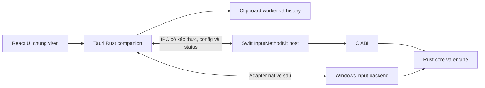

# 00. Tổng quan hệ thống — VXKey

> **Skill:** `_spec0_system`  
> **Version:** 0.5.1 — **Ngày cập nhật:** 2026-10-30  
> **Trạng thái:** Đã soạn để review; chưa được user xác nhận specs ready.  
> **Đối tượng:** Dev, UI/UX, QA và AI Execution Agents.  
> **Nguồn scope:** [Tổng quan](00_system_overview.md); quyết định UI Tauri chung Mac/Windows của user.

## 1. Mục tiêu, alternatives và scope

Bộ gõ Việt Mac trước, bảo toàn văn bản, dễ đổi VI/EN, quản lý app policy và có clipboard history tích hợp. User chọn Tauri UI chung với Windows: chấp nhận thêm WebView/IPC để tái sử dụng layout/copy/Settings, giữ engine native để không tăng latency nhập liệu. Phương án giữ SwiftUI ít packaging hơn nhưng không đạt mục tiêu UI chung; viết lại IME bằng event tap/JS tăng rủi ro và không được chọn.

Upstream Mac hiện có IMKServer + InputMethodKit và SwiftUI MenuBarExtra/Settings/onboarding trong cùng process; việc tách UI sang companion là thay đổi kiến trúc có chủ đích, phải migration theo từng milestone. Upstream Windows có hook/SendInput + Slint; Tauri thay lớp UI, không tự đổi backend thành TSF. Chưa có native acceptance Windows.

## 2. Kiến trúc đích

Companion sở hữu đúng một tray/status item, UI, config authority, clipboard và updater coordinator. IME có cache config last-known-good, status snapshot và composition state riêng; không chờ companion trên từng phím. Companion không nhận raw keystrokes, surrounding text hoặc composition buffer. Tắt/chết UI vẫn gõ được; tắt IME không tắt clipboard. React dùng Tauri commands đã allowlist, không localhost HTTP server.

## 3. Requirement registry

| ID | Invariant / hành vi |
|---|---|
| KEY01 | Không xóa/sửa prefix hoặc suffix ngoài vùng được chứng minh; selection hợp lệ số học chưa chứng minh đúng ngữ nghĩa |
| KEY02 | Focus/source đổi không commit buffer cũ sang client mới |
| KEY03 | Hard bypass ngừng macro/retone/direct writes/engine cho app; toggle VI không tự xóa rule |
| KEY04 | Memory VI/EN, input bypass và clipboard block là ba policy độc lập, exact bundle ID |
| KEY05 | EN là chế độ ngôn ngữ; English macro chỉ chạy nếu được bật riêng |
| KEY06 | Panel/Settings/helper nội bộ không tạo memory entry hoặc consume pending choice |
| KEY07 | Tray hiển thị mode hiệu lực; mất snapshot không báo live sai |
| KEY08 | WebView/clipboard/DB/helper lỗi không chặn IME hot path |
| KEY09 | Install/update/uninstall chỉ tác động ownership VXKey, rollback giữ ABC/Funput |
| KEY10 | Có recovery bằng mouse/native/OS khi input lỗi; fault injection bắt buộc trước daily-driver |
| TYP01 | Giữ đủ upstream desktop typing/settings/utilities; gap công nghệ có evidence |
| TYP02 | Double-space defaults Mac off/Win on, macOS native interlock, rewrite an toàn |
| CFG01 | Single-writer config, revision, atomic persist; lỗi không báo đã lưu |
| IPC01 | Command/peer allowlist, revision/target validation; không raw text qua IME IPC |
| UI01 | UI Tauri chung Mac/Win, locale độc lập chế độ gõ, Settings theo suite |
| CLP01 | Opt-in; filter trước payload; pause/lock/resume không backfill |
| CLP02 | Exact text copy-back, không auto-paste, own-write không tạo loop hoặc đè copy mới |
| CLP03 | Bounded history, delete/clear/expiry và lỗi store/key có trạng thái thật |
| UPD01 | Update có xác thực, single-flight, quiesce/handoff/rollback, giữ config và quyền đã kiểm chứng |

## 4. Defaults đề xuất để review

| Key | Type / default | Quy tắc |
|---|---|---|
| `ui_locale` | vi/en; lần đầu theo OS vi nếu phù hợp, còn lại en | Lưu sau user chọn, không đổi language_mode |
| `tray_icon_style` | serious/playful; serious | V/E hoặc Ư/W; chỉ đổi icon, không đổi engine |
| `theme` | system/dark/light/pure_black; system | Chỉ expose mode đã apply thật |
| `input_method` | telex/telex_advanced/vni; telex | Apply tại boundary composition an toàn |
| `tone_style` | modern/traditional; modern | Preview bằng fixture, giữ consistent tests |
| `language_mode` | vi/en; vi | Chỉ hiệu lực khi source VXKey active |
| `remember_per_app` | bool; true | App chưa có memory dùng global language_mode |
| `composition_mode` | preedit/direct_verified; direct_verified | Kế thừa tính năng gõ không gạch chân; chỉ direct khi range/client được chứng minh, fallback preedit |
| `macros_enabled` / `macros_in_en` | bool; true / true | Kế thừa upstream; hard bypass vẫn tắt toàn bộ xử lý |
| `smart_restore` / `eager_restore` / `retone` | bool; true | Kế thừa upstream, regression và safe-range guards vẫn bắt buộc |
| `spell_check` / `auto_capitalize` | bool; false | Kế thừa upstream |
| `extra_onsets` | unique array z/f/w/j; [] | Cho chọn từng phụ âm đầu |
| `macro_smart_case` | bool; true | Matching và expansion casing theo upstream |
| `double_space_period` | bool; Mac false, Windows true | Default chỉ cho cấu hình mới; native macOS on thì VXKey bị khóa |
| `toggle_hotkey` / `flip_hotkey` / `history_hotkey` | Mac toggle Control+Option; Windows toggle Control+Win; Mac history Control+Command+V; Windows history Win+V qua provider selector; flip null | Cho custom, hỗ trợ modifier-only; native acceptance theo02 mục14 |
| `clipboard_enabled` | bool; false | Onboarding opt-in, không bật từ import |
| `history_mode` | session/encrypted; session | M4a session; M4b encrypted opt-in riêng |
| `history_max_entries` / `history_ttl_days` | int; 200 / 7 | Limits theo clipboard spec |
| `launch_companion_at_login` | bool; false | User chốt giữ mặc định tắt khi chưa an toàn; không tự bật sau checks/update |

Macro/import/config export có nội dung user, không gửi telemetry. Không AI/learning/cloud/ảnh/file/auto-paste ở Mac v1; giữ cả công cụ chuyển mã/chuyển kiểu chữ upstream qua UI Tauri; không tự cắt capability vì đổi UI. Windows UI có thể reuse source từ đầu nhưng chỉ claim Windows support sau backend/native gates riêng.

## 5. Feature catalog và phạm vi handoff

| Feature ID | User outcome | Flow | Screen | Requirement | Mốc |
|---|---|---|---|---|---|
| F01 | Bật được nguồn nhập VXKey và biết khi chưa sẵn sàng | FL01 | S03 | KEY07/09 | M3c |
| F02 | Gõ Telex/Telex nâng cao/VNI, đổi VI/EN và giữ văn bản | FL02/03 | S01/S02 | KEY01/02/05/07 | M2 |
| F03 | Nhớ ngôn ngữ và chặn xử lý phím theo app | FL04 | S02/S04 | KEY03/04/06 | M2/M3b |
| F04 | Đổi Settings, import/export/reset có readback | FL05 | S02 | CFG01/UI01 | M3 |
| F05 | Tìm và copy lại text đã sao chép | FL06/07 | S05 | CLP01/02/03 | M4a |
| F06 | Lưu history mã hóa qua restart khi opt-in | FL08 | S02/S05 | CLP03 | M4b |
| F07 | Cài/gỡ/update có rollback và ownership | FL09 | S03/S07 | KEY09/UPD01 | M3c/M6 |
| F08 | Chuyển mã/chuyển kiểu chữ text và batch files | FL11 | S08 | TYP01/KEY09 | M3 |
| F09 | Hai Space tạo dấu chấm và Space | FL10 | S02 | TYP02/KEY01/KEY03 | M2/M3 |
| F10 | Tạm ngừng và khôi phục nhập liệu khi lỗi | FL13 | S01/recovery native | KEY10/KEY08 | M2/M5 |
| F11 | Icon nghiêm túc hoặc nhây | FL14 | S01/S02 | UI01/KEY07 | M3 |

Tất cả feature đều có Gherkin và edge matrix tại [QA](05_qa_acceptance.md). Feature ở milestone sau vẫn có đặc tả để không phá identity/data từ đầu; không dựng controls giả cho backend chưa có.

## 6. Hợp đồng đọc và thứ tự ưu tiên

User instructions → quy chuẩn workspace → bộ spec này → code hiện tại. Số hiệu requirement có một nguồn tại mục3; state/flow tại02, presentation tại03, field/command/schema tại04, expected result tại05. File07 chỉ quản lý milestone/build/install integration, không định nghĩa lại field/schema. Nếu code hiện tại khác contract, báo gap và thực hiện migration theo task; không coi code cũ là lý do đổi spec âm thầm.

Bộ spec không yêu cầu một REST server: API ở04 là typed Tauri invoke và IPC native. BPMN được thể hiện bằng swimlane Mermaid ở01, không tuyên bố đã xuất BPMN XML2.0. Các số mặc định đề xuất phải được review; không gán thành số liệu thực đo. Namespace/signer/feed là blocking decisions trước artifact phụ thuộc, không placeholder đem ship.

## 7. Chất lượng handoff theo skill coordinator

- Dev: có actors, business rules, pre/postconditions, typed commands/errors và schema.
- UI: có cây component, kích thước, states, keyboard, responsive/native adaptation và visual prompts.
- QA: mỗi feature có Given/When/Then, negative/boundary cases, data validation và artifact evidence.
- Demo: có seed data, clickthrough, timeline, câu thoại và contingency.
- Cross-spec: feature→flow→screen→command→test mapping trong05; kiểm structural trong schema/links chỉ là một lớp, không thay review logic/native.

## 8. Quyết định UX — Current-app exclusion

User chọn cơ chế giống action “Tắt mkey cho ChatGPT” trong menu tham chiếu: S01 có “Tắt/Bật VXKey cho {app hiện tại}”, thao tác hard bypass một bước cho app trước khi mở menu. Đây là phần mở rộng F03/KEY03/KEY04/KEY06, không phải feature clipboard hoặc global off. Contract FL04a ở02, component/labels ở03, command/token ở04, scenarios Q25..Q27 ở05. Không đòi mở Settings để loại trừ app hiện tại.

## 9. Quyết định scope — Giữ đầy đủ tính năng upstream

User yêu cầu clone toàn bộ tính năng Funput có thể giữ được về công nghệ, không cắt tùy chọn vì mục tiêu MVP hoặc vì đổi SwiftUI sang Tauri. Phạm vi parity là bộ gõ desktop và các tiện ích desktop đã có; không tự mở release mobile/Linux hoặc tái dùng identity/feed/key của Funput. Khi có rào cản thật: ghi capability/platform/evidence/cách khắc phục vào gap, giữ backlog, không silently drop. Windows vẫn triển khai sau Mac, UI dùng chung không thay runtime gates.

| Upstream Mac capability / key | VXKey mapping | Trạng thái contract |
|---|---|---|
| Telex / TelexAdvanced / VNI | typing.input_method | Giữ đủ3mode |
| ToneStyle modern/traditional | typing.tone_style | Giữ |
| smartEnglishRestore / eagerRestore | smart_restore / eager_restore | Giữ; eager chỉ hiệu lực khi smart bật |
| spellCheckEnabled / autoCapitalizeEnabled | spell_check / auto_capitalize | Giữ |
| extraOnsets | extra_onsets array z/f/w/j | Giữ master switch + từng chữ |
| directComposition | composition_mode | Giữ gõ không gạch chân, thêm safety fallback |
| retoneAfterBackspace | retone | Giữ; upstream có setting ẩn, VXKey có thể expose ở nâng cao |
| shortcutsEnabled / shortcutsInEnglish / shortcutSmartCase | macros.enabled / in_en / smart_case | Giữ đầy đủ, không ép literal-only |
| toggleShortcut / flipShortcut | shortcuts.toggle / flip | Giữ; handler IME native |
| showMenuBarIcon / launchAtLogin | system.show_tray_icon / launch_companion_at_login | Giữ; ẩn tray vẫn mở launcher để khôi phục |
| Config import/export / per-app memory | Commands hiện có | Giữ, migration explicit |
| Convert text / files / batch | S08 Conversion + native backend worker | Giữ; Unicode/TCVN3/VNI-Windows/Unicode tổ hợp |
| Upper/lower/no-diacritics/sentence/title | Conversion transform pipeline | Giữ order/undo/clear, keep_d/flatten_caps |
| Onboarding/About/update entry | Surface VX tương ứng | Giữ capability, dùng metadata/trust VXKey |

Thêm requirement `TYP01`: parity settings và tính năng upstream có mapping/test, không cắt thiếu bằng UI port. Thêm `TYP02`: hai Space tạo dấu chấm + Space theo platform defaults và native interlock. F02 mở rộng parity typing; F08=conversion desktop; F09=double-space punctuation.

Core probe actual source (rustc1.99, không full engine/native): Telex `w→w`, `vwng→vwng`, `vuwng→vưng`, `vungw→vưng`; TelexAdvanced `w→ư`, `vwng→vưng`, `thw→thư`, `nhwng→nhưng`. “Leading w” nghĩa là trước nguyên âm chính, có thể sau phụ âm đầu; không chỉ vị trí ký tự0. Chưa đổi default Telex thành Advanced thay user.

## 10. Quyết định shortcut, startup và icon

User dùng ổn định hai tổ hợp modifier-only nhiều năm: default Mac Control+Option, Windows Control+Win; cho custom và giữ chính xác defaults này. Không tự thay vì cảnh báo chung. Các guard chống toggle nhầm không thay hành vi bấm quen thuộc; unsupported native delivery phải báo integration gap, không fake active.

Autostart mặc định **tắt trong giai đoạn chưa đạt an toàn input** theo chỉ đạo mới nhất. Sau khi đạt các gate vẫn không tự bật: muốn đổi default cần user chốt riêng; update/import không tự bật registration. Companion autostart không đồng nghĩa OS tự chọn VXKey input source; IME lifecycle/source persistence do OS quản lý, phải hướng dẫn đường thoát riêng.

Tray style `serious` mặc định: VI dùng glyph **V**, EN dùng **E**; `playful`: VI dùng **Ư**, EN dùng **W**. User chuẩn bị4SVG, không tạo asset giả. Style chỉ là presentation, state engine vẫn vi/en/bypass/inactive/unavailable. Accessibility vẫn đọc Tiếng Việt/English, không đọc glyph nhây thành tên chế độ.

Requirement `KEY10`: có đường tạm ngừng/recovery không phụ thuộc phím gõ qua engine, lỗi input được cô lập và kiểm chứng fault injection trước daily-driver; tham chiếu [brainstorm và contract phục hồi](08_keyboard_resilience.md). F10=resilience/recovery, F11=tray icon style.

## 11. Clipboard history shortcut

User chốt Mac default Control+Command+V, cho custom. Map vật lý sang Ctrl+Win+V trên Windows trùng shortcut Windows11 mở sound output/volume mixer; không dùng làm default hoặc cướp system shortcut. Windows native history là Win+V, giữ nguyên; VXKey Theo chỉ đạo sau đó, Windows giữ Win+V và cho user chọn provider native hoặc VXKey, default native để giữ hành vi OS. Đây là conflict đã xác minh từ tài liệu Microsoft, không cùng trường hợp Ctrl+Win modifier-only toggle user đã chốt.

## 12. History provider Windows và kiểm Control+V trên Mac

User yêu cầu giữ Win+V và cho chọn native Windows hoặc VXKey. `clipboard.windows_history_provider=native|vxkey`, default native; đây là chọn bảng nào xử lý Win+V, không tự disable native clipboard storage/sync. Mac tiếp tục Control+Command+V/custom; user mới hỏi Control+V có trùng gì, chưa chốt đổi shortcut. Control+V có nghĩa cuộn xuống một trang/chuyển insertion point trong macOS text editing theo [Apple Pages](https://support.apple.com/en-au/guide/pages/-tanc0ffef022/mac), không coi là tổ hợp trống.
