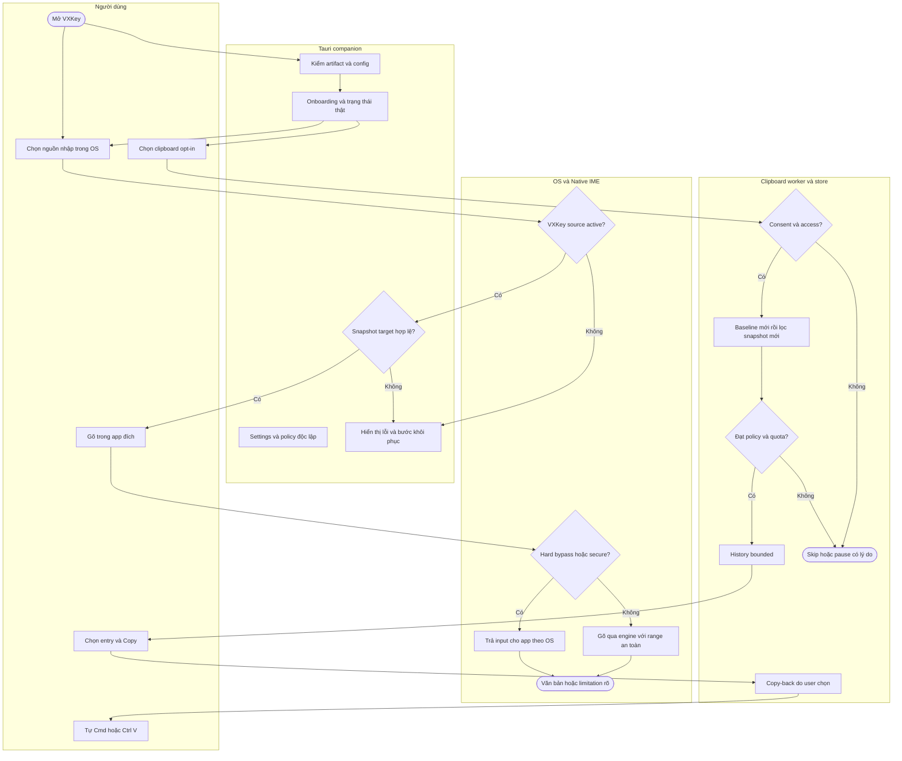

# 01. Quy trình nghiệp vụ — VXKey

> **Skill:** `_spec1_business_process`  
> **Version:** 0.4.0 — **Ngày cập nhật:** 2026-10-30  
> **Trạng thái:** Đã soạn để review; chưa được user xác nhận specs ready.  
> **Đối tượng:** Dev, UI/UX, QA và AI Execution Agents.  
> **Nguồn scope:** [Tổng quan](00_system_overview.md); quyết định UI Tauri chung Mac/Windows của user.

## 1. Mục đích, actors và ranh giới quy trình

Mục tiêu là giữ nhịp nhập liệu của user, cho phép đổi chế độ theo app và tra lại clipboard với consent riêng. Quy trình bắt đầu khi mở companion/chọn nguồn nhập; kết thúc ở kết quả gõ/copy, trạng thái suy giảm có thể xử lý, hoặc tắt/gỡ có rollback. Không đọc tài liệu user để chẩn đoán.

| Lane / actor | Đầu vào | Trách nhiệm | Không sở hữu |
|---|---|---|---|
| User | Lựa chọn UI, phím gõ, copy event | Chọn source/consent/mode/entry/action | Không phải tự sửa IPC/config file |
| Hệ điều hành / app đích | Focus, input source, secure state | Giao input cho IME, clipboard/permissions | Không bảo đảm app đích trả selection đúng |
| Native IME | Key event, client và config cache | Composition, mode/policy resolve, status | Không host React/history DB/updater |
| Tauri companion | User actions, typed status | Một tray/UI, config authority, worker coordination | Không nhận raw keystrokes/text quanh caret |
| Clipboard worker/store | Clipboard snapshot đủ policy | Filter/read/store/search/copy-back | Không tham gia gõ hoặc auto-paste |
| Installer/update helper | Payload/manifest/job đã xác thực | Stage/swap/rollback/receipt | Không cấp quyền OS hoặc xóa Funput |

## 2. Swimlane quy trình tổng thể



History hoạt động khi dùng ABC nếu companion có consent/access; nhánh clipboard không phụ thuộc O0. Diagram này là swimlane logic, các state machine chi tiết ở02.

## 3. SIPOC

| Supplier | Input | Process | Output | Customer |
|---|---|---|---|---|
| User + OS input source | Key/client/focus | Resolve policy → composition an toàn | Văn bản trong đúng app | User đang gõ |
| User + app metadata | Exact ID và rule | Validate → persist → apply tại boundary | Memory/bypass/block riêng biệt | IME và clipboard worker |
| Clipboard producer | Types/count/source hints | Filter trước payload → bounded capture | Entry đủ điều kiện hoặc skip | User mở history |
| User trong history | ID/revision/action copy | Recheck state/count → write snapshot | Clipboard hiện tại hoặc lỗi | User tự paste |
| Release owner được ủy quyền | Signed versioned pair | Verify → quiesce → swap/rollback | Bundle pair/receipt | User cài hoặc cập nhật |

## 4. Business decision table

Luật từ trên xuống trong từng nhóm; `*` là bất kỳ. Không gộp language mode với bypass hoặc UI locale.

| Rule | Nhóm | Điều kiện | Quyết định | Hậu điều kiện |
|---|---|---|---|---|
| BR01 | Input | Source khác VXKey | Không tự giành nguồn nhập | Tray inactive, clipboard độc lập |
| BR02 | Input | Secure field/OS không giao input | Tôn trọng OS, không đọc/rewrite | Không dùng bypass để né OS |
| BR03 | Input | Active + app hard bypass | Trả input, không macro/retone/engine | Toggle VI giữ rule |
| BR04 | Input | Active + không bypass + memory có | Dùng memory app | App ID nội bộ không được lookup như target |
| BR05 | Input | Active + app chưa nhớ | Dùng global default | Chưa có user action thì không tạo memory |
| BR06 | Rewrite | Range/focus/selection chưa chứng minh | Không direct write | Preedit session mới hoặc limitation |
| BR07 | Mode command | Target token stale | Reject stale_target | Không đổi mode/memory app khác |
| BR08 | Capture | Chưa opt-in/off/pause/lock/deny | Không materialize | Resume/grant dùng baseline mới |
| BR09 | Capture | Block marker/type/source hoặc source mơ hồ | Skip trước text read | Không preview/hash/persist |
| BR10 | Capture | Pass policy + valid bounded text | Dedup/prune/store | Copy giữ text exact |
| BR11 | Store | Encrypted mode + key/store lỗi | Pause và error | Không fallback plaintext hoặc báo empty giả |
| BR12 | Copy | Explicit action + valid entry + unlocked | Recheck count rồi write | Không auto-paste/restore delayed |
| BR13 | Config | Persist/validation/revision lỗi | Reject mutation | UI không báo saved |
| BR14 | Update | Chưa click CTA hoặc busy/quiesce chưa ack | Không install | Không tự arm install muộn |

## 5. Machine-readable business contract

```yaml
process: vxkey_daily_use
input_policy_order: [other_source, secure_input, hard_bypass, app_memory, global_default]
clipboard_policy_order: [consent, unlocked, access, markers_and_types, source_policy, text_validation, quota]
independent_policies: [language_memory, input_bypass, clipboard_blocked]
prohibited_data_routes:
  - raw_keystrokes_to_companion
  - surrounding_text_to_companion
  - clipboard_body_to_ime
  - history_to_config_export
failure_domains:
  companion_down: ime_uses_validated_cache
  clipboard_worker_down: ime_continues
  ime_down: clipboard_independent_and_tray_unavailable
```

## 6. Bottleneck, sự cố và vận hành dự phòng

| Điểm gián đoạn | Tác động | Fallback / người chịu trách nhiệm |
|---|---|---|
| App trả selection sai | Nguy cơ sửa ngoài vùng user | IME không direct write; QA Q01 trước dogfood |
| Companion mất kết nối | Không cập nhật UI/config live | IME dùng cache, tray báo unavailable khi có UI |
| Clipboard provider treo | Worker không phản hồi | Worker isolation/recovery; không chặn IME |
| Signing/IPC identity chưa thiết lập | Không chứng minh peer trust | Chỉ fixture transport, chặn native distributable |
| Installer đổi được một component | Pair không tương thích | Helper journal restore cả pair trước success |
| User không muốn history | Không có consent | Bộ gõ vẫn hoạt động, không prompt lặp |

## 7. BR15 — Loại trừ app đang dùng ngay từ menu

User đang ở external app A → mở tray → thấy “Tắt VXKey cho A” → click → rule input bypass exact ID được lưu → IME áp tại safe boundary. Mở menu lần sau ở A hiển thị “Bật VXKey cho A”. Không mở picker cho luồng này; picker dành thêm/quản lý app khác.

App không xác định hoặc focus đã đổi thì disable/reject, không loại trừ nhầm VXKey hay app B. User action này không đổi VI/EN memory, clipboard blocklist, global engine hoặc companion lifecycle. Reference MKey là hành vi thao tác nhanh; không tự sao chép các submenu/tính năng khác trong ảnh.

## 8. BR16/BR17 — Parity và quyền sở hữu dấu câu

BR16: Giữ toàn bộ tùy chọn/desktop utilities Funput có thể port. Rào cản thật phải có evidence/gap, không tự giảm capability do UI Tauri. Không clone identity/update feed/key hay mở release nền tảng chưa được giao.

BR17: Mac native period=on → VXKey toggle disabled/effective off; native=off → toggle enabled theo stored preference; native=unknown → khóa tạm và không rewrite. Windows fresh profile preference=true, Mac=false; user explicit choice luôn thắng fresh default. Global shortcut remapping (ví dụ screenshot Win+Shift+S) ngoài scope; không thêm hook tổng quát vào IME để đồng bộ phím toàn máy.
