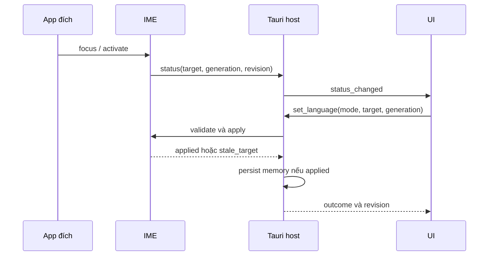
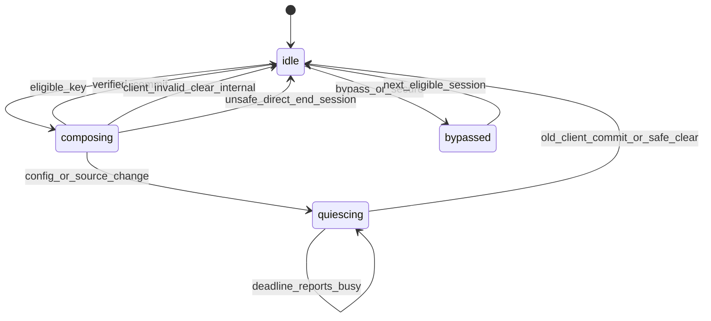
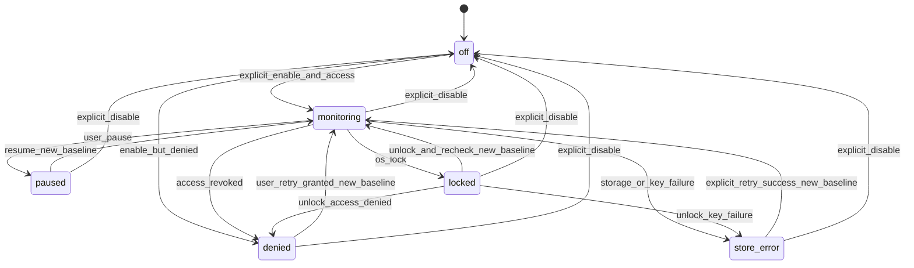
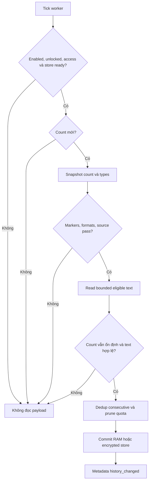
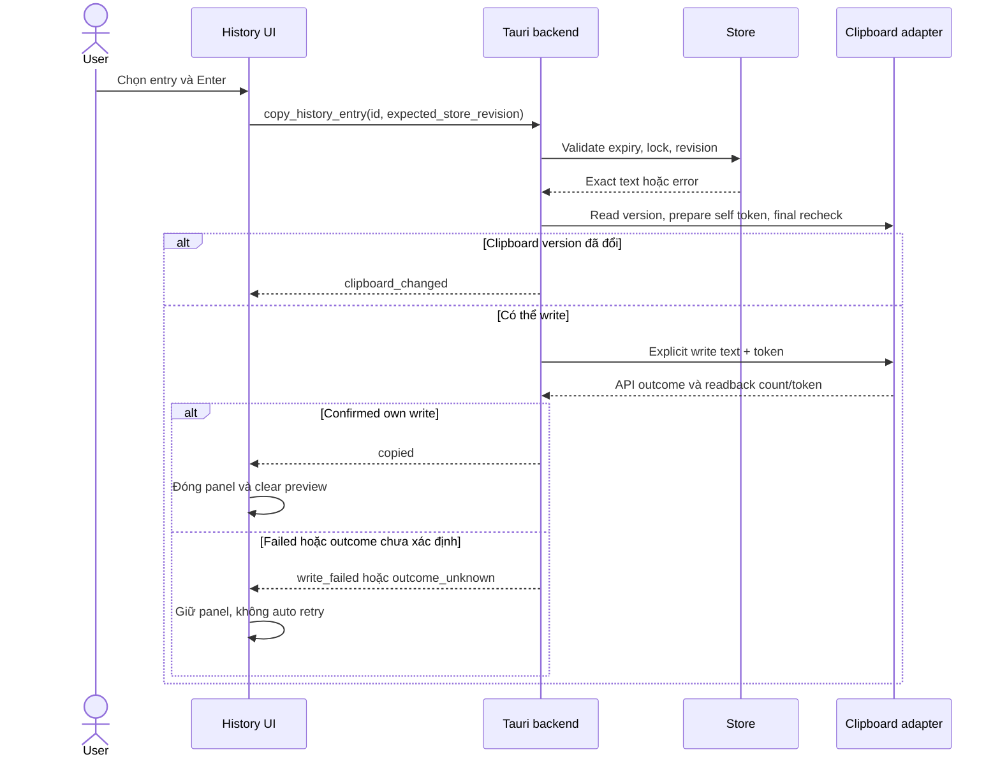

# 02. Feature flow và state diagrams — VXKey

> **Skill:** `_spec2_feature_flow`  
> **Version:** 0.5.1 — **Ngày cập nhật:** 2026-10-30  
> **Trạng thái:** Đã soạn để review; chưa được user xác nhận specs ready.  
> **Đối tượng:** Dev, UI/UX, QA và AI Execution Agents.  
> **Nguồn scope:** [Tổng quan](00_system_overview.md); quyết định UI Tauri chung Mac/Windows của user.

## 0. Feature flow catalog

| Flow ID | Trigger / actor | Precondition | Success exit | Error / alternative exit |
|---|---|---|---|---|
| FL01 | User mở launcher/onboarding | Companion chạy được | Source readback active + ready | Để sau/missing IME/other source, không fake ready |
| FL02 | User gõ | Client/source hợp lệ | Text update đúng vùng | Secure/bypass/pass-through; unsafe range skip |
| FL03 | Mode action/hotkey | Target snapshot hợp lệ hoặc global action rõ | Applied mode, persistence status đúng | stale_target/unavailable/persist_failed |
| FL04 | User thêm/sửa app policy | Exact app ID xác nhận | Rule saved và runtime boundary ack | Cancel/conflict/client changed |
| FL05 | User chỉnh/import/export/reset | Config schema/revision hợp lệ | Persist + readback, engine pending/apply rõ | Validation/persist conflict giữ config cũ |
| FL06 | User opt-in rồi có clipboard mới | Access, unlocked, policy pass | Entry bounded | Skip/filter/denied/provider timeout |
| FL07 | User search/select/copy | Store unlocked, entry valid | Clipboard write confirmed, đóng panel | Revision/count changed, write error giữ panel |
| FL08 | User bật persistence | Secure store/key sẵn sàng | Encrypted transaction và readback | Error pause, không plaintext |
| FL09 | User chọn install/update/remove | Ownership/trust gate đạt | Pair receipt/rollback và trạng thái thật | Busy/quiesce timeout/partial swap/relaunch pending |

## 1. State và phân xử

```text
language_mode = vi | en
source_status = vxkey_active | other_source | unknown
engine_status = ready | unavailable
connection_status = connected | disconnected | incompatible
composition_state = idle | composing | quiescing
clipboard_state = off | monitoring | paused | locked | denied | store_error
```

Resolve tray: health suspended → effective_mode=suspended (neutral icon, saved mode không mất); sau đó source other → inactive; source unknown hoặc stale/disconnected → unavailable; active nhưng engine unavailable → unavailable; active + exact app bypass → bypass; còn lại language_mode. Memory chỉ resolve khi focus vào external app có identity xác định. Không xác định app thì không lưu memory, áp global và chọn preedit; clipboard source ambiguity bị skip.

## 2. Onboarding

Mở launcher → companion single-instance → chọn locale → giới thiệu bộ gõ → kiểm IME bundle/version → hướng dẫn Add Input Source bằng OS UI → readback source active → test trên ô fixture → clipboard opt-in riêng → hoàn tất. “Để sau” ở input source không giả ready, vẫn vào Settings/history nếu user bật. Không tự chọn input source hoặc xin Accessibility cho typing/copy-back. Onboarding luôn mở lại được.

## 3. Toggle, focus và pending

Snapshot target gồm external bundle ID, PID, focus_generation do IME quan sát. Mở UI giữ snapshot external target; chuyển focus riêng sang surface VXKey không làm tăng external focus_generation, không coi WebView là target nhập liệu. Chọn VI/EN gửi command kèm snapshot và revision. Backend chỉ áp vào target nếu generation còn khớp; target đã đổi → `stale_target`, UI refresh và yêu cầu user thao tác lại. Không giữ pending vô hạn hoặc áp lựa chọn cho app kế tiếp.

Khi chọn mode từ Settings mà không có target hợp lệ: chỉ sửa global default, ghi rõ “Mặc định cho ứng dụng chưa ghi nhớ”; không sửa memory app cuối. IME hotkey khi đang trong client hợp lệ đổi mode và gửi memory update async; IME áp ngay trong session, khi companion vắng thì giữ memory delta trong RAM, không ghi file chung.



Companion không phản hồi: toggle vẫn gõ/đổi được trong session; không tự đợi timeout trên phím. Reconnect merge memory delta theo ordered session sequence chỉ nếu policy revision của app chưa đổi từ lần snapshot; conflict ưu tiên config authority và báo delta bị bỏ, không overwrite rule user vừa sửa.

## 4. Composition safety

| Event | Hành động |
|---|---|
| Phím thông thường, bypass | Trả nguyên input, không engine/macro |
| Secure field / secure input | Tôn trọng OS, không đọc/rewrite text; không bypass bảo vệ OS |
| Direct rewrite | Kiểm client/focus generation, range UTF-16, text vùng sở hữu; selection không-zero hoặc selection đáng ngờ → không direct rewrite |
| Không đủ bằng chứng range | Không destructive write; ngừng direct session, chuyển preedit cho session mới |
| Client cũ còn hợp lệ khi đổi config/source | Commit marked text bằng API client cũ, rồi reset |
| Client cũ không còn hợp lệ | Clear internal buffer, không write vào client mới; không tự replay phím |
| Config engine đổi khi composing | Queue config revision tới idle hoặc kết thúc session an toàn; UI hiện pending |
| Bật bypass giữa session | Quiesce client cũ trước; nếu không thể chứng minh client, clear nội bộ và bypass; không retone muộn |

Không hứa fallback sửa được mọi client. Nếu client không hỗ trợ an toàn, báo limitation và hướng dẫn ABC; không toggle direct tự động vì tên app có trong trust list.

## 5. App policy và config

App picker đọc bundle metadata để user xác nhận exact ID/path; tên chỉ để hiển thị. Các cột memory / không xử lý phím / không lưu clipboard độc lập. Xóa rule bypass giữ clipboard block và memory; Forget language chỉ xóa memory. Khi app không còn cài vẫn giữ rule có nhãn “Không tìm thấy ứng dụng”.

Settings safe change → validate → persist revision → phát config event → IME apply/ack tại safe boundary. UI phân biệt saved/pending_engine/error. Reset preferences có confirmation nêu phạm vi; giữ locale, macros, app policies, history, key và quyền OS. Muốn xóa các data này dùng action riêng.

## 6. Panel và lifecycle

History hotkey → snapshot external app → show panel/focus search. Escape/click ngoài đóng; không auto-paste hoặc auto restore clipboard. Copy thành công đóng panel; failure giữ panel và selection. OS lock → đóng panel, xóa search/preview/decrypted cache; resume baseline clipboard mới. Quit companion dừng history/tray/UI, nhắc IME còn hoạt động; không kill IME. Disable input source là action OS riêng. Update quiesce theo install spec.


## 7. State diagrams và transition matrix



`bypassed` là trạng thái xử lý session, không đổi language_mode đã lưu. Quiesce không cho installer tiến khi chưa ack; hết deadline báo busy, không ép write/kill. Focus generation thay đổi invalidate mọi deferred callback của session cũ.



Enable consent/key failure không giả monitoring: encrypted mode enable thiếu key chuyển store_error; enable lúc locked giữ locked với requested_enabled=true, chưa poll. Off không tự clear entries. Khi lock từ paused nhớ requested pause, unlock trở lại paused thay vì tự monitoring.

| State A | Event / guard | State B | Side effect / UI |
|---|---|---|---|
| monitoring | New snapshot, filter pass | monitoring | Validate/read/store, history_changed metadata |
| monitoring | Block types/source/marker | monitoring | Skip payload, không history event chứa text |
| monitoring | Provider deadline | store_error | worker restart hữu hạn, UI retry, IME tiếp tục |
| any capture state | Open panel, unlocked | Giữ capture state | Loading → list/empty/no_results/error |
| panel loading | New query revision | loading | Hủy/discard result cũ |
| panel ready | Copy action | copying | Disable action lặp |
| copying | Confirmed write | hidden | Không tự paste/restore |
| copying | Error/count changed | ready + error | Giữ selection, retry do user |
| panel any | Lock | hidden | Clear UI/search/decrypted cache |
| settings clean | Safe preference edit | saving | Host validate/persist |
| saving | Persist success | saved / pending_engine | UI phân biệt disk saved với runtime applied |
| saving | Error | error | Revert committed value, giữ user draft để sửa |

## 8. Clipboard capture và copy-back



Capture algorithms/limits ở [data contract](04_api_data.md#8-clipboard-data-lifecycle-và-store); consent/error UI ở03. Trước read không bảo đảm provider trả nhanh/nhỏ: provider isolation spike bắt buộc, không xem byte check sau read là đủ.



## 9. Logic execution contracts

### `FL03.set_language`

Preconditions: source VXKey active, connection compatible, external target token(session/PID/app/generation) hợp lệ. Steps: validate mode → IME revalidate token → apply mode tại safe boundary → trả applied session sequence → companion commit memory nếu chưa có config conflict. Postconditions: UI chỉ báo applied khi có ack; disk failure không phủ nhận mode đã đổi trong session, hiện applied_not_saved và retry persistence có kiểm revision. Disconnect trước ack → outcome_unknown, query status khi reconnect, không gửi lại mode mutation mù quáng.

### `FL05.patch_config`

Preconditions: expected_revision=current và request hợp schema. Steps: validate allowlist → persist single transaction → config_changed revision → IME async safe apply → ack. Postconditions: persisted revision và applied revision riêng; timeout runtime không rollback file đã saved hoặc báo disk error giả. Engine-facing settings sửa giữa composition có pending indicator. Theme/locale không chờ IME.

### `FL06.capture_new_snapshot`

Preconditions: requested_enabled && !paused && unlocked && access. Steps: snapshot metadata → filter → bounded provider read → stable-count check → validate text → dedup/quota → transaction. Postconditions: blocked/unstable snapshot không được hash/index/preview; next tick tiếp tục hữu hạn. Resume/unlock baseline không capture nội dung đang có.

### `FL09.install_pair`

Preconditions: explicit action, authenticated payload, ownership paths đúng, old pair recoverable. Steps: stage → verify → quiesce → helper ack/journal → pair swap → relaunch/version readback → receipt. Error: quiesce chưa ack thì giữ pair; partial swap phải restore pair, receipt không success từ spawn. Chi tiết operational integration ở07.

## 10. Phạm vi reset và draft transaction

Reset preferences chỉ reset theme và nhóm typing về defaults trong00; giữ ui_locale, remember_per_app, language_memory, mọi app policy, macros, hotkeys đã đăng ký, capture enable/pause/history mode/limits, autostart, consent/OS permissions và key/history. Confirmation liệt kê Theme và Bộ gõ, không gọi thao tác này là xóa toàn dữ liệu. Reset typing giữa composition đi safe boundary như patch_config. Các nhóm được giữ có action riêng; không reset hotkeys/capture làm side effect.

Inline editing macro/import dùng draft rõ ràng: sửa một draft chưa persist; Save macro hoặc Commit import validate toàn transaction, Cancel giữ revision/data trước. Theme/locale và checkbox an toàn áp ngay; không có Save chung cho cả Settings. Close khi có macro draft hỏi Lưu/Bỏ thay đổi/Ở lại; chọn lưu mà lỗi thì giữ cửa sổ và draft.

## 11. FL04a — Loại trừ app hiện tại từ tray

Trigger: user click icon menubar/system tray rồi chọn action theo app. Precondition: host chụp được external app trước menu activation; app không phải companion/IME/helper hoặc system surface không có identity phù hợp.

1. Native tray-open callback lấy app identity/PID và external focus generation trước khi show WebView, tạo target_token opaque gắn với phiên panel và config revision. Nếu không lấy được target ngay ở lúc mở, chỉ dùng snapshot external vừa được OS xác nhận còn hiện tại; không fallback app cũ bất kỳ.
2. UI đọc metadata app_name và bypass hiện tại. Chưa bypass → “Tắt VXKey cho {app}”; đã bypass → “Bật VXKey cho {app}”.
3. Click gửi desired boolean, expected_revision và target_token; không gửi thao tác toggle mù để double-click thành bật lại.
4. Host serialize mutation, validate revision và token còn thuộc panel đang mở, app/PID chưa mất, không có external focus change. VXKey UI lấy focus không làm target stale; chuyển sang external app khác thì stale_target.
5. Persist riêng input_bypass cho exact app ID; giữ clipboard_blocked và language_memory. Nếu chưa có policy thì clipboard_blocked default false. Khi disable bypass=false và cả hai flags false có thể remove policy record, vẫn giữ memory.
6. Publish revision cho IME. Có composition cũ thì quiesce đúng client theo mục4 trước runtime bypass; không commit vào client mới. Chưa có IME/source active thì vẫn lưu policy, UI ghi saved/pending_engine đúng trạng thái; không tự chọn nguồn nhập.
7. Success đóng panel. Persist failure giữ menu và báo error, không giả rule mới. Engine apply pending không giả runtime đã áp, trạng thái tiếp theo lấy ack.

Postconditions: Settings→Applications phản ánh cùng rule sau restart. App khác không đổi. Bật lại chỉ gỡ hard bypass, dùng mode đã nhớ/default; không tự bật clipboard hoặc ép VI. Token vô hiệu khi panel đóng, process target thoát hoặc external app đổi. Reopen tạo token mới; host kiểm token, không tin app_name/UI app ID.

## 12. FL10 — Hai Space thành dấu chấm và Space

Native input backend sở hữu punctuation, không WebView/clipboard listener/global remapper. `double_space_period` là stored preference. Fresh config: macOS=false, Windows=true; có giá trị explicit thì giữ, không tính lại mỗi startup/update/import. Runtime native state không lưu như grant vĩnh viễn.

Preconditions: VXKey backend đang active, không hard bypass/secure input; tính năng enabled, native owner cho phép; biết đúng client/focus/caret/selection và sở hữu Space thứ nhất. VI/EN đều có thể dùng punctuation, còn hard bypass thắng. App dùng ABC trên Mac không được companion inject tính năng này toàn máy.

1. Space thứ nhất là unmodified keydown, không autorepeat/paste/programmatic; finalize composition/macro ở boundary như upstream và giữ đúng một U+0020 đã được client xác nhận. Lưu token gồm session/client/focus_generation/caret, monotonic time và edit revision; không gửi text ra companion.
2. Space thứ hai phải là distinct unmodified keydown trong500ms; trước Space đầu có grapheme letter/digit do session xác minh. Không áp đầu dòng, sau whitespace/tab/newline hoặc punctuation `.?!,:;`; không sửa indentation.
3. Revalidate native period state/client/caret/no-selection/document edit revision và Space đầu vẫn đúng vị trí sở hữu. Đổi focus/caret/source/native state, phím khác hoặc repeat thì clear token, Space sau giữ hành vi thường.
4. Trong một edit transaction, thay Space đầu bằng `. ` và consume Space thứ hai; không để thành `word . `, `word.. ` hoặc mất suffix. Nếu không chứng minh range/transaction được thì không rewrite, để Space đi qua bình thường.
5. Sau transform clear token, không chain Space3 thành dấu chấm khác. Undo transaction phục hồi hai Space; Backspace theo hành vi app bình thường, không thêm hidden rewrite. Adapter không giữ được undo/range phải có gap và native test trước expose supported.

State `idle→first_space_owned→converted→idle`; timeout/invalid_context/native_enabled→idle không rewrite. Macro expansion trước Space đầu phải hoàn tất; không retone chữ cũ trong lúc đổi dấu câu.

macOS native `enabled`: VXKey runtime không xử lý, UI disabled; native `disabled`: user bật được VXKey; `unknown`: không rewrite và báo chưa xác định. Khi OS bật/tắt trong lúc chạy, update runtime revision, cancel pending token trước transform; không tự sửa OS preference. Source/field có xử lý riêng vẫn phải kiểm actual tail, không cam kết mọi app dùng cùng substitution behavior.

## 13. FL11 — Giữ tính năng chuyển mã/chuyển kiểu chữ

Open S08 → paste explicit hoặc native picker/drop file → backend session xác định source charset hoặc yêu cầu user chọn → chọn target/ordered transforms → preview/loss warnings → Copy/Save/Run batch explicit → report written/skipped/failed. Giữ input/outputs độc lập, Undo/Clear transform không sửa nguyên bản. Files ghi bản sao ở output folder được công bố, không overwrite originals hoặc đích tồn tại; path token host-owned, staging/no-clobber commit, Cancel không ghi. Không suy “clone” cho phép chạy std::fs::write vào path chưa verify; typing không chờ conversion worker.

## 14. FL12 — Modifier-only toggle defaults và custom

Stored shortcut là typed chord, không chuỗi accelerator không phân biệt modifier/key. Default Mac={control,alt}, Windows={control,meta}; alt hiển thị Option trên Mac, meta hiển thị Win trên Windows. Áp cho VI/EN trong source/backend active, không phải bộ remap toàn hệ thống. Side trái/phải đều được; theo dõi physical down/up từng bên trước khi tổng hợp modifier family để không nhầm release trái/phải.

State idle→candidate khi bắt đầu nhấn modifier; armed khi đã từng đạt chính xác toàn combo và không có modifier/phím ngoài combo. Chỉ fire một lần khi cả modifier trong combo đã được thả. Nếu có phím thường, modifier ngoài combo, focus/source/session đổi, secure transition hoặc suspend thì cancel; tất cả keydown/up vẫn đến OS/app theo đường không compose. Ctrl+Win+Arrow/D, Ctrl+Option+phím khác không toggle trước khi phím thứ3 tới. Held/repeat không toggle nhiều lần. Key-chord custom tiếp tục xử lý theo exact modifiers+physical key.

Mac mở recognizedEvents/handling phù hợp flagsChanged (upstream hiện keyDown-only), không thêm global event tap chỉ để lấy chord. Windows mở rộng/reuse release watcher của upstream, ignore self-injected events và không nuốt modifier vật lý để đợi phím. Không synth key-up cho modifier đang giữ thật. Verify chord-only không bật Start hoặc menu ngoài ý muốn; Windows AltGr/remote desktop/remappers được matrix riêng. Suspend/bypass ưu tiên hơn toggle, không tự thoát safe mode bằng mode shortcut.

## 15. FL13/FL14 — Recovery và tray style

FL13: mouse/launcher recovery→native health snapshot→request input_suspended=true→ack hoặc timeout thật→nếu worker không ack, supervisor xử lý owned worker theo08→user chọn nguồn thay thế/Resume explicit. Suspend dừng composition/macro/retone/period/injection, clipboard/UI độc lập; không replay text/phím đã có outcome không chắc chắn. Safe-start marker chặn auto re-enable sau fault/restart, giữ tới explicit Resume.

FL14: System radio serious/playful→patch_config.ui.tray_icon_style→persist revision→tray render asset theo effective_mode hiện tại→UI readback. Style change không set_language, không đổi keyboard/source, không ảnh hưởng bypass/suspended status.

## 16. FL15 — Chọn clipboard provider cho Win+V

Windows Settings→Clipboard provider native/VXKey. Native: không intercept, OS popup hoạt động. VXKey: explicit user selection→native scoped routing preflight/ack→persist+effective route→Win+V mở đúng1S05. Access/capture chưa consent chỉ mở off/consent surface, không tự monitor.

Đổi về native, quit/crash/safety suspend hoặc route unhealthy→remove/release interception và verify→native hiệu lực. Restore failure phải hiện unknown/unavailable, không giả Windows đã nhận key. Không xóa hoặc đồng bộ history stores, không đổi OS global clipboard policy. State/commands chi tiết04 mục16; Q42 kiểm both directions và fault. Ctrl+Win+V không thuộc rule Win+V, vẫn tới OS; mode modifier-only candidate cancel khi có V.
