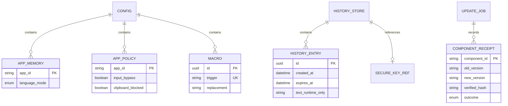

# 04. API contracts, data model và integration — VXKey

> **Skill:** `_spec4_api_data`  
> **Version:** 0.5.1 — **Ngày cập nhật:** 2026-10-30  
> **Trạng thái:** Đã soạn để review; chưa được user xác nhận specs ready.  
> **Đối tượng:** Dev, UI/UX, QA và AI Execution Agents.  
> **Nguồn scope:** [Tổng quan](00_system_overview.md); quyết định UI Tauri chung Mac/Windows của user.

## 1. Ownership và identity

| Component | Owner / lưu trữ | Production ID |
|---|---|---|
| Tauri companion | UI/tray/config/history/updater | Chưa chốt namespace; gate ID01 |
| Swift IME | IMKServer/C ABI/session, không tray/Settings riêng | Chưa chốt bundle/source/mode/connection IDs; gate ID01 |
| Installer/update helper | Staging/verify/swap/receipt | ID/signing theo cùng ownership manifest |

ID01 trước build cài được: manifest liệt kê companion/IME/helper/input-source/IMK connection/URL scheme/config root/Keychain service/access group/signer DR/feed key. Đối chiếu convention VX và quyền sở hữu namespace; không lấy `app.funput.*`, feed/key/Team ID của upstream. Không tự chọn một namespace giả làm production. ID symbolic `companion_id`/`ime_id` trong spec không phải string ship.

Config/history dưới Application Support/VXKey trên Mac, AppData/VXKey trên Windows; resolves qua platform API. File mới snake_case. Per-user ACL giới hạn user; config macros có thể nhạy cảm, không log/export tự động. Chưa dùng App Group entitlement nếu signer/provisioning không đáp ứng; không thêm entitlement giả để share file.

## 2. Config authority và schema

Companion là writer duy nhất `config.json`, atomic temp+fsync+rename cùng volume, revision tăng đơn điệu sau commit. IME cache read-only config tối thiểu tại root cùng user, cập nhật snapshot atomic bởi companion; never write concurrent UserDefaults/file. Cache không chứa clipboard. Dữ liệu sai/corrupt dùng last-known-good validated snapshot và báo error, không ghi đè file lỗi bằng defaults. IME cold start không có cache dùng safe defaults trong core.

Config đầy đủ xem [config_example.json](config_example.json), validate bằng [config_schema.json](config_schema.json).

Required fields theo ví dụ; unknown schema_version lớn hơn → read-only incompatible, không downgrade. Unknown field trong version1 import → reject, không âm thầm bỏ. revision là decimal-string uint64; enum như core. maps exact external bundle ID; memory value vi/en, policy value `{input_bypass:boolean,clipboard_blocked:boolean}`. Config serialized tối đa1MiB UTF-8 cho toàn object (kể cả JSON escaping); reject mọi mutation vượt tổng cap dù từng macro còn dưới limit. Giới hạn import1MiB UTF-8, tối đa2000 distinct app IDs trong union memory/policies, macro entries1000; reject duplicate key/ID. Macro `{id:UUID,trigger:string,replacement:string}`: trigger1..32 Unicode scalars không whitespace/control; replacement1..8192 UTF-8 bytes, cho phép multiline; trigger uniqueness theo smart_case flag như upstream; macro áp dụng tại word boundary, re-case expansion khi smart_case bật. Engine không đáp ứng contract thì chặn capability, không đổi nghĩa âm thầm.

## 3. Import/export/migration

Export opt-in ra file bằng native save dialog, cảnh báo macros có nội dung nhạy cảm; không history/key/permission receipt. Import validate toàn bộ → preview diff → user chọn replace preferences hoặc merge macro/app rules → commit một transaction. Merge giữ local khi trùng ID/trigger, hiển thị số skipped; không ghi domain Funput. Clipboard enabled và autostart không được bật qua import; OS permissions không import. Cancel/error giữ config cũ.

Funput migration chỉ explicit read-only chọn nguồn và preview; legacy excludedApps chỉ migrate remembered EN, không biến thành hard bypass. Vì upstream schema thay đổi, adapter phải pin schema/commit và test fixture trước expose Import Funput. Namespace VXKey chưa có → không tạo dữ liệu giả. Reset preferences theo flow spec, data delete bằng action riêng. Revision từ file import chỉ là metadata: commit gán local revision+1 sau kiểm expected_revision, không nhận counter bên ngoài làm authority. Nếu config mới tạo import thiếu field bắt buộc thì reject; không tự merge defaults che lỗi schema.

## 4. Tauri WebView boundary

Chỉ local bundled UI; CSP cấm remote scripts/navigation/frames/eval, không remote URL WebView. `opener` chỉ allowlist HTTPS URLs đã xác minh; native file dialogs giới hạn import/export, không arbitrary filesystem/shell invoke. Capabilities theo window label: Settings có config commands, history có history commands, onboarding chỉ capability tối thiểu. Frontend không nhận keychain key hoặc encrypted key; không gửi clipboard body sang IME.

Command registry và field chính xác chỉ định tại mục7.2; không có command aliases khác trong runtime.

Host revalidates mọi field/size/revision bất kể frontend. History window không có patch config hoặc update install. Events `config_changed`, `runtime_changed`, `history_changed`, `update_changed`: chỉ metadata/revision; WebView request selected content khi cần. Lock đóng/hủy requests và xóa UI memory.

## 5. IME ↔ companion IPC

macOS đề xuất authenticated local Unix-domain socket trong per-user runtime directory0700, socket0600; không TCP/listen toàn máy. Verify peer same UID và code-signing identity/DR đã pin bằng platform API trước handshake. Không đủ authenticated identity ở dev → chỉ fixture transport, không tuyên bố production-safe. Windows sau dùng named pipe ACL current user + peer identity/session validation. Không đưa credential vào socket path/log.

Frame: uint32 big-endian byte length + UTF-8 JSON; tối đa2MiB; reject invalid/oversized frame, disconnect. Message `{protocol_version:1,request_id:UUID,session_id:UUID,sequence:counter_string,type:enum,payload:object}`; duplicate/out-of-order sequence rejected. Handshake trao component/version/config_revision; protocol mismatch → incompatible, không apply. Allowed types handshake/status/config_snapshot/config_ack/set_language/language_result/memory_delta/quiesce/quiesce_ack. Payload typed như core/flow; unknown type/field rejected. Clipboard body/raw key/text context không có message type.

Snapshot status: source_status, engine_status, effective_mode, target(nullable DTO ở mục9), focus_generation counter_string, applied_revision, composing bool; không document title hoặc text. Heartbeat1s; mất3 heartbeat → stale/unavailable, reconnect backoff1/2/4/8/30s; không poll trên key handler. UI command timeout2s không giả success; IME apply ack có revision, async; quiesce deadline5s, timeout chặn install. Đồng bộ config không yêu cầu disk/network trên IME hot path. Replay command cũ sau reconnect bị từ chối bởi session_id/generation.

## 6. Errors và concurrency

Outcome `{ok:boolean,request_id,data|null,error|null}`; error `{code,message_key,retryable}`. Codes: invalid_argument, revision_conflict, stale_target, unavailable, incompatible_protocol, permission_denied, clipboard_changed, store_corrupt, key_unavailable, quota_exceeded, persist_failed, busy, timeout, signature_invalid, unsupported, not_found, entry_expired, locked, write_failed, outcome_unknown. Không HTTP status giả cho local IPC. Error details không payload text/path nhạy cảm. Conflict refresh snapshot rồi user retry; không blind retry mutation. Store/config locks tách nhau, worker không giữ lock khi gọi UI/IME/provider.


## 7. Typed request/response contract và data model

### 7.1. Transport và representation

Không public REST/GraphQL endpoint. UI gọi `invoke("vxkey_command", {request: DTO})`; DTO có discriminator `command` đúng registry; mọi DTO field snake_case, reject unknown fields. Mọi response dùng envelope ở mục6, không lẫn Tauri reject string tùy ý. Request_id UUID do host cấp/gắn correlation cho response, không gửi text vào error detail. Các uint64 crossing JS được encode decimal string (regex `^(0|[1-9][0-9]{0,19})$`, range≤18446744073709551615), không JSON number vượt precision JS. Các counter/config schema trong package dùng representation string thống nhất, default revision `"1"`.

[config_schema.json](config_schema.json) là schema normative của config trên disk/DTO; [config_example.json](config_example.json) là valid example; [command_schema.json](command_schema.json) là request union cho toàn bộ25commands trong registry. Semantic validators bổ sung byte length, duplicate keys, identity ownership và peer trust; JSON Schema không chứng minh những điều đó.

### 7.2. Commands chi tiết

`patch_config.changes` chỉ cho ui.locale/theme/tray_icon_style; typing defaults (language_mode ở đây là global default, không đổi target app ngay); apps.remember_per_app; clipboard.max_entries/ttl_days; system.show_tray_icon. Không trực tiếp patch macros, app maps, shortcuts, consent, history_mode, autostart, revision/schema hoặc identity. Nested patch merge đúng field, không reset field vắng. Macro/app/permission actions đi command riêng có validators. `get_snapshot` không chứa macro bodies; `list_macros` là Settings-only.


| Command | Required payload / constraint | Success data | Mutation/error |
|---|---|---|---|
| get_snapshot | object rỗng | config_without_macro_bodies + runtime + capabilities + revision | Không đọc history; macro bodies qua macro tab riêng |
| patch_config | expected_revision:string, changes:typed partial object | persisted_revision:string, applied_revision:string, engine_ack_state:applied/pending/unavailable | Reject protected clipboard consent/autostart/identity fields; revision_conflict |
| set_language | mode:vi/en, target:{app_id,pid,ime_session_id,focus_generation} | language_mode, runtime_sequence:string, persistence:saved/pending/failed | stale_target, outcome_unknown; không retry mutation mù |
| set_app_policy | expected_revision, app_id, input_bypass:bool, clipboard_blocked:bool | revision, apply_state | Exact ID; không sửa memory ngầm |
| forget_app_language | expected_revision, app_id | revision, removed:bool | Idempotent theo data, revision still checked |
| list_apps | query≤256scalars, limit1..100, offset0..10000 | items[{app_id,display_name,path,availability}], has_more | Không quét ổ đĩa nội dung user |
| list_macros | expected_revision, offset, limit1..50 | items[{id,trigger,replacement}], revision | Settings only, không get_snapshot tất cả text |
| replace_macros | expected_revision, enabled,in_en,entries | revision, apply_state | Validate limits/uniqueness toàn bộ trước commit |
| list_history | query≤256scalars, offset0..200, limit1..50 | items[{id,preview,created_at,byte_length}], total, store_revision | Snapshot stable, không full text mọi mục |
| get_history_entry | entry_id UUID, expected_store_revision | id,text,byte_length,store_revision | locked/not_found/entry_expired/revision_conflict |
| copy_history_entry | entry_id UUID, expected_store_revision | copied:true, clipboard_write_id UUID | clipboard_changed/write_failed/outcome_unknown |
| delete_history_entry | entry_id UUID, expected_store_revision | removed:bool, store_revision | Không chỉnh clipboard hiện tại |
| clear_history | expected_store_revision, confirmation_id UUID | deleted_count, store_revision | Confirmation bound clear dialog/window/action, single-use30s |
| set_capture_state | action:enable/disable/pause/resume/retry, consent_id nullable | capture_state, permission_status | enable yêu cầu consent receipt backend; không tự tạo receipt từ bool |
| prepare_import | native dialog action, không input path UI | import_id UUID, diff summary, expires_at | Token120s, validated bytes held host, không đọc lại path thay đổi |
| commit_import | import_id, expected_revision, mode:replace_preferences/merge_data | revision, skipped_count | Revalidate revisions, single-use; Cancel bỏ token |
| export_config | native save dialog action | exported:bool | User chọn Cancel → exported=false, không error giả |
| register_hotkey | expected_revision, action:toggle/flip/history, shortcut:ShortcutBinding/null | revision, registration_state | History: OS global register rồi persist, rollback khi fail. Toggle: IME-local validation/ack, không global hook |
| set_launch_at_login | enabled:bool, expected_revision | actual_enabled, revision | OS ack; error không fake stored enabled |
| set_history_mode | mode:session/encrypted, transition:keep_session/clear_all, confirmation_id | mode, store_revision | Key/store gate, không plaintext fallback |
| reset_preferences | expected_revision, confirmation_id | revision, preserved_fields | Scope cố định theo02/03, không reset data/locale |
| update_action | action:check/install/restart, expected_job_id:null/UUID | job_id,state | Single-flight; unsupported/dev trả lỗi typed |

Capabilities(window,command) phải implement ở host, không chỉ ẩn button. Native About và open URLs có action allowlist riêng, không shell generic. `get_snapshot` enum capability phân biệt supported/unavailable/not_implemented; no coming-soon controls. Existing overview example config macro entries trống chỉ là example, không trường hợp được phép leak macro bodies cho mọi window.

### 7.3. Ví dụ request/response và lỗi

```json
{
  "request": {
    "command": "set_app_policy",
    "expected_revision": "8",
    "app_id": "fixture.editor",
    "input_bypass": true,
    "clipboard_blocked": false
  }
}
```

```json
{
  "ok": true,
  "request_id": "17fd9cee-0233-4d87-a25c-885fc75d312d",
  "data": {"revision": "9", "apply_state": "pending"},
  "error": null
}
```

```json
{
  "ok": false,
  "request_id": "17fd9cee-0233-4d87-a25c-885fc75d312d",
  "data": null,
  "error": {"code": "revision_conflict", "message_key": "errors.revision_conflict", "retryable": true}
}
```

Fixture app_id trong ví dụ không phải production ID. HTTP codes N/A vì không có HTTP server; error code typed là nguồn branch. retryable chỉ có nghĩa user có thể retry sau refresh/resolve condition, không cho phép auto replay mutation.

### 7.4. Entity relationships và constraints



ERD là logical model, không yêu cầu map config JSON thành SQL tables. Config single-writer JSON; session history RAM; encrypted history DB chỉ opaque ID/ciphertext/schema. Crypto key không nằm trong JSON/DB. Source hints không join app memory như trusted provenance.

## 8. Clipboard data lifecycle và store

### 8.1. Phân kỳ và data ownership

M4a: opt-in, text-only session RAM, search/preview/copy-back/delete/clear/pause. M4b: encrypted persistence opt-in, giữ qua restart, sau key/store/privacy gates. Không ảnh/file/RTF fidelity/cloud/learning/auto-paste. Clipboard worker thuộc Tauri backend, có thể isolated subprocess nếu provider-read spike yêu cầu; không chạy trong IME hoặc React interval.

| Field | Type / constraint |
|---|---|
| id | UUID, immutable |
| created_at / expires_at | UTC timestamp, expiry theo policy; dùng clock injected trong tests |
| text | exact valid Unicode string, 1..131072 UTF-8 bytes; không trim/normalize |
| byte_length | actual UTF-8 count |
| source_hint / source_quality | nullable exact app ID / verified_hint, observed, unknown; không giả guaranteed provenance |
| store_revision | decimal-string uint64 tăng khi mutation |

Giới hạn: max200 entries, TTL7ngày, max128KiB/item, tổng10MiB text bytes. UI cho sửa entries1..200, TTL1..7ngày; max item/tổng cố định v1. Quá item size → skip toàn item, không truncate rồi lưu. Quá count/bytes → prune oldest trước commit. Prune trước query/copy và mỗi60s khi active; expiry check khi unlock/startup; clock rollback không kéo dài entry quá TTL tính theo elapsed khi process còn sống. Clock bất thường qua restart → pause hiển thị cần kiểm thời gian, không hứa TTL tuyệt đối bằng clock tường.

### 8.2. Capture state machine

Off → user opt-in → baseline changeCount hiện tại, không đọc nội dung có sẵn → kiểm access → monitoring. Pause/off/lock/deny → ngừng materialize; unlock/resume/grant lại → baseline mới, không backfill. Off không tự clear history; UI nói rõ và có Clear riêng. Session quit mất history, UI giải thích trước khi bật. Permission grant không tự restart hành động copy/paste cũ.

Poll đề xuất500ms trên worker phù hợp API platform; không hứa ghi mọi lần copy nhanh. Snapshot count/types → policy → read permitted text → count sau → chỉ accept nếu ổn định. Count đổi discard, retry tối đa1 lần ở tick sau; không busy loop. Provider read deadline mục tiêu1s: timeout không hủy được native call thì cô lập/restart worker trước production, không chỉ bọc timeout rồi để threads tăng vô hạn. Spike provider blocking là gate M4.

### 8.3. Filter trước payload

1. Skip concealed/transient/auto-generated markers và own-write token đã xác minh của instance.
2. Skip file/image/multi-item mixed/remote markers; plain URL text cho phép, không fetch.
3. Nếu observed app hoặc source hint nằm clipboard blocklist thì skip. Hint producer tự khai không là authentication.
4. Missing/ambiguous/racing source → skip bảo thủ; gắn source_quality cho entry được nhận, UI không hứa chặn toàn bộ secrets.
5. Chỉ khi pass types/source mới materialize plain text; reject invalid/empty/oversized. Không hash/index/preview payload bị blocked.
6. Sau filter: dedup chỉ consecutive exact text từ nguồn đủ điều kiện, giữ entry mới nhất timestamp mới; không dedup hash secret trên disk. Nonconsecutive copy cùng text có thể tạo entry mới.

Có thể không nhận được một số copy hợp lệ do source không chắc; status trợ giúp giải thích. Không dùng clipboard thật của user làm fixture privacy, không suy frontmost luôn là producer. Password managers phải thử từng app/version; plain secret không marker không thể nhận diện chắc chắn.

### 8.4. Copy-back và race

User chọn entry → validate ID/revision/expiry/unlocked → chụp current clipboard version → chuẩn bị text + unique self token → recheck version ngay trước write. Nếu đổi → clipboard_changed, giữ panel, user retry. Adapter phải ghi types/text/token trong một transaction API khi có; rollback không được clear clipboard mới sau lỗi. Sau write confirm API success + observed count/token khớp mới báo copied. Không restore clipboard sau delay. Own-write suppression dựa instance token + expected count, không dùng global timer/content hash khiến bỏ copy mới.

Không có compare-and-swap xuyên mọi OS clipboard API: race giữa final check và write vẫn có thể xảy ra. Spike đo và ghi limitation, không claim atomic guarantee nếu API không hỗ trợ. Không can thiệp background, chỉ write do click/Enter của user. Mac copy-back ưu tiên current-host-only nếu adapter hỗ trợ đã QA; nếu Tauri plugin không expose thì viết native adapter, không giả hỗ trợ. UI đóng sau success, user tự Cmd/Ctrl+V.

### 8.5. Persistence và lifecycle

Session mode: RAM only, không DB/temp plaintext/log/crash payload. Encrypted mode: record text và sensitive metadata mã hóa authenticated encryption; key random256-bit lưu OS secure store thuộc companion identity. Metadata disk tối thiểu opaque UUID/schema/encrypted blob; không plaintext preview/source/FTS. Search decrypted bounded RAM khi unlocked, không SQLite plaintext index. Nonce unique mỗi write, schema/record ID làm authenticated data; dùng library đã review, không tự viết crypto.

DB/WAL/backup chứa ciphertext; transaction delete/clear áp DB, index/cache và WebView content; khóa/clear RAM best effort, không hứa xóa vật lý SSD/swap/OS backups. Key unavailable/corrupt DB → pause, error, không regenerate key rồi báo empty. Recovery explicit chọn retry hoặc xóa store lỗi với confirmation; không plaintext fallback. Persistence disabled: xác nhận xóa persistent records, giữ session hay clear theo user chọn; Keychain key chỉ xóa trong action clear persistent store đã công bố, không xóa signer/system credentials.

Lock: đóng panel, drop decrypted cache và queries, capture stopped; unlock phải recheck permission/key, baseline mới. Helper crash không làm lỗi IME; session data mất được nêu rõ; encrypted store transactional recovery. Quota provider memory và blocking gate riêng, byte limit sau read không chứng minh resource safety.

### 8.6. Privacy UX và permission

Consent nói rõ lưu bản copy mới, session hay qua restart, limits, pause/clear và giới hạn lọc secrets. Không xin FDA/Input Monitoring/Accessibility cho copy-only. Clipboard permission ask/deny/revoke xử lý trên đúng companion identity theo OS/runtime API; không sửa TCC hoặc loop prompts. Windows adapter nghiên cứu riêng, không port boolean macOS thành quyền giả. History không xuất cùng config, không telemetry/URL preview/đọc typed text. Không kiểm soát history Spotlight/Handoff của OS hoặc app khác.


## 9. Native IPC payloads và version compatibility

Frame/session/auth ở mục5 là yêu cầu đề xuất cần spike chứng minh peer identity; socket0600 cùng UID chưa đủ xác thực app. Mọi native counter dùng decimal strings như7.1, kể cả trên wire để DTO chung.

| Type | Direction | Required payload |
|---|---|---|
| handshake | Hai chiều | component:ime/companion, app_version, protocol_version:1, config_revision, peer_nonce |
| status | IME→host | source_status, engine_status, effective_mode, target nullable, applied_revision, composing:bool, runtime_sequence |
| config_snapshot | Host→IME | config_revision, typing, macros, remember_per_app, language_memory, input_policies; không UI/history/clipboard |
| config_ack | IME→host | config_revision, apply_state:applied/pending/rejected, error_code nullable |
| set_language | Host→IME | mode, target, expected_runtime_sequence |
| language_result | IME→host | outcome:applied/stale_target/unavailable, runtime_sequence, mode nullable |
| memory_delta | IME→host | app_id, mode, base_config_revision, runtime_sequence |
| quiesce | Host→IME | job_id, deadline_utc |
| quiesce_ack | IME→host | job_id, state:idle/busy, applied_revision |

Target DTO: app_id external exact ID, pid positive int32, ime_session_id UUID, focus_generation counter string. Internal UI opening does not invalidate target token by itself; external focus change/client change increments generation. Track original external target separately from OS frontmost UI, otherwise menu click would make every command stale. Source change invalidates token. Quiesce ack không là quyền kill process của OS.

Heartbeat dùng status, monotonic runtime_sequence; no replay queue across sessions. Schema version mismatch → companion read-only incompatible; protocol mismatch → IME cached operation, UI unavailable. Pair install tương thích theo manifest, không tự downgrade schema để reconnect.

## 10. Shortcut ownership

`toggle` và `flip` do IME xử lý trong client khi VXKey source active, không companion global listener thứ hai. Khi companion chết, IME dùng validated shortcut cache, vì vậy typing/mode toggle vẫn hoạt động. Validator reject tổ hợp OS-reserved đã biết, duplicate với history shortcut, unsupported modifier-only cho flip/history và unsupported key; không tuyên bố phát hiện được mọi xung đột shortcut bên trong app khác. Companion sửa shortcut qua config và nhận IME ack ở safe boundary.

`history` do companion đăng ký global hotkey qua platform API; quit companion giải phóng registration. Register failure không persist active giả, đổi shortcut thành null là unregister. Không event tap/Input Monitoring chỉ để lấy shortcut. Một action không được có hai owner hoặc hai listener. Windows adapter phải đạt cùng ownership contract trước expose shortcut như supported. Win+V provider route là ngoại lệ scoped ở mục16, không đi registration generic.

## 11. Command `set_current_app_bypass`

Invoke `vxkey_command` với request `{command:"set_current_app_bypass",target_token:UUID,expected_revision:counter_string,input_bypass:boolean}`. Success data `{revision:counter_string,input_bypass:boolean,apply_state:"applied"|"pending"|"unavailable"}`; app identity không lấy từ display label UI. Errors: stale_target/revision_conflict/persist_failed/invalid_argument. Không yêu cầu IME đang active để lưu rule; native runtime application vẫn theo config ack contract.

Host giữ target_token→{app_id,pid,external_focus_generation,panel_session_id} trong RAM; token chỉ tồn tại trong lifetime phiên panel, không persist/export/log. Tray-open response bổ sung `{current_app:{display_name,app_id,input_bypass,target_token}|null}` cho S01; không thêm field vào native IME target DTO. S01 token do companion quan sát OS, không dùng IME token cũ khi source ABC. Host reject internal/self surfaces, app đổi/PID thoát hoặc panel session đã đóng.

Patch duy nhất input_bypass trong config authority transaction, giữ policy clipboard flag và memory. Không route command này thành set_language hoặc thay toàn policy bằng booleans UI đã stale. Command allowed cho tray panel và Settings quick-action surface nếu được triển khai; history/onboarding không có quyền gọi. Native menu/React phải share backend command để kết quả giống nhau.

## 12. Config parity và native double-space capability

Schema/example cập nhật theo00: typing thêm eager_restore, spell_check, extra_onsets và double_space_period; macros thêm smart_case; shortcuts thêm flip; system thêm show_tray_icon. `replace_macros` nhận smart_case, không cố định case-sensitive/literal-only nữa: matching/re-case theo upstream, validate duplicates theo engine khi smart_case bật. `register_hotkey.action` thêm flip, owner IME-local giống toggle. Toggle default Mac Control+Option, Windows Control+Win; không chặn global screenshot shortcut.

[platform_defaults.json](platform_defaults.json) là nguồn default có platform của double_space_period: macos=false, windows=true. [config_example.json](config_example.json) là Mac fresh config; [config_example_windows.json](config_example_windows.json) minh họa Windows fresh config. Không một universal JSON Schema default=false được dùng để tạo config Windows. Loader nhận OS target thật, áp default chỉ cho field chưa tồn tại, persist một lần; migration/import có giá trị explicit giữ nguyên, runtime OS lock không overwrite stored choice.

`get_snapshot.runtime.period_substitution`={native_state:enabled|disabled|unknown|not_applicable,preference:bool,effective_enabled:bool,control_enabled:bool,reason:native_enabled|checking|user_disabled|ready|unsupported,capability_revision:counter_string}. IME native monitor đọc cùng native state để quyết định, không phụ thuộc WebView đang mở hoặc sync command trên mỗi phím.

Mac adapter dùng public AppKit `NSSpellChecker.isAutomaticPeriodSubstitutionEnabled`, theo dõi `NSSpellChecker.didChangeAutomaticPeriodSubstitutionNotification`; SDK27 header khai báo cả getter và notification. Verify process/cross-process delivery bằng native fixture; refresh khi Settings/panel mở, companion/app activate, source/client activate và sau wake. Nếu notification không tới ổn định, adapter phải resample bounded trên native lifecycle/idle; không dùng read cached preference vô hạn hoặc read disk sync trên key event. Lúc chưa có trạng thái tin cậy đặt unknown và không transform. Không sửa NSGlobalDomain/TCC hoặc preference toàn máy.

Public API: [Apple period substitution property](https://developer.apple.com/documentation/appkit/nsspellchecker/isautomaticperiodsubstitutionenabled). Property phản ánh setting OS; không chứng minh mỗi field hỗ trợ substitution, phải QA native/AppKit/browser/Electron riêng. macOS đang bật native thì khóa VXKey theo quyết định user ngay cả khi một app không tự xử lý.

Trong patch_config, typing.double_space_period=true trên Mac khi native enabled/unknown trả capability_locked; false vẫn cho persist tắt nếu cần. Nếu stored preference đã true trước đó rồi native bật thì giữ true nhưng effective_enabled=false và control disabled. `runtime_changed` mang metadata capability revision, không native text. Native-state đổi khi command inflight phải revalidate; không enable từ stale UI. Thêm error capability_locked, invalid_context.

## 13. Conversion integration boundary

S08 giữ API session của `funput-convert` hiện có và port presentation sang React; không gọi IME IPC cho văn bản/tệp conversion. Companion Rust link crate, worker riêng, không kéo clipboard polling vào engine. Trước M3 conversion phải expose typed wrappers và generate DTO từ session/view/actions của pinned upstream, bổ sung vào command_schema; schema command registry hiện tại chưa bao gồm wrappers conversion, đây là integration gate chưa được giải quyết chứ không capability bị loại. Mapping giữ ConvertAction paste/pickFiles/setInput/setSource/setTarget/setRowSource/copyResult/saveResult/convertFiles/loadMore/receiveFiles/restart và ConvertCasingAction apply/undo/clear/keepD/flattenCaps.

File paths từ native dialogs/drop đi host-owned token, không arbitrary path/shell do React cung cấp; mutation phải atomic/no-clobber, symlink/target revalidate. Preserve original bytes, output conflict tạo tên mới hoặc báo lỗi, không overwrite; partial success count theo readback. Explicit Paste/Copy conversion không tự bật history, own clipboard write đi cùng token suppression. Batch/file read limits, cancellation và DTO/output pagination phải được spike trên pinned upstream trước chốt typed wrappers, không báo toàn bộ converter dev-ready từ việc liệt kê feature.

## 14. ShortcutBinding, tray style và input suspension

Config ui.tray_icon_style enum serious/playful, default serious. shortcuts.toggle/flip/history dùng ShortcutBinding|null, thay string accelerator cũ trong draft chưa release. Discriminated union: `{kind:"modifier_chord",modifiers:[control|alt|shift|meta]}` với2..4modifier families unique, chỉ toggle; hoặc `{kind:"key_chord",modifiers:[...],key_code:string}` có≥1modifier và physical code do adapter hỗ trợ. No extra fields; reject unsupported key/platform, duplicate với action khác, modifier-only history/flip. Native cache/DTO của shortcut dùng cùng representation. Imported legacy draft string nếu có chỉ explicit migration parser/preview, không reinterpret silently.

register_hotkey: expected_revision + action + shortcut(nullable) → revision + registration_state; history đăng ký global thật, toggle/flip native-local ack. Recorder không đưa modifier_chord vào API OS cần virtual key. Không tự đổi default người dùng chọn do collision assumption; known conflict hiển thị và cho custom. VoiceOver/remap coexistence tests là gates, không auto disable VoiceOver.

Command `set_input_suspended`: `{command,target_session_id:UUID|null,suspended:boolean,reason:user|fault_recovery}`; success `{suspended,engine_session_id,health_state}` chỉ sau ack hoặc verified process stop/unhook. Resume reason user, phải same session hoặc native health check mới; không tự resume bằng replay request. Native IPC thêm suspend_processing/suspend_ack và runtime status health_state:healthy/degraded/suspended/unresponsive, engine_event_loop_sequence + recovery_reason(metadata). Supervisor phải heartbeat main input event loop, không thread phụ còn sống nhưng input đã deadlock. Runtime suspended ưu tiên mọi compose paths; native mode vi/en chỉ saved preference, không status active giả.

recovery_state.json thuộc VXKey-only data root do supervisor/companion authority ghi atomic: suspended bool, reason_code, failed_component_version, incident_id UUID; không raw key/text. Sau fault/startup đọc marker trước attach Windows hooks/enable transformations; schema/config corruption không xóa marker. Clear chỉ explicit user Resume đã health check. Companion autostart false default; activation/source persistence do OS không nằm trong marker registration.

## 15. Clipboard history shortcut conflict policy

Platform defaults: macOS shortcuts.history={kind:key_chord,modifiers:[control,meta],key_code:KeyV}; Windows meta+KeyV qua provider selector. meta hiển thị Command trên Mac, Win trên Windows. Windows ctrl+meta+KeyV là known OS conflict với sound output; register_hotkey action history trả shortcut_conflict, không tự remap/hook để chiếm. Windows meta+KeyV được route theo provider selector; default native. macOS ctrl+meta+KeyV vẫn kiểm actual registration conflict; stored default không có nghĩa registration đã thành công.

Nguồn: [Microsoft Windows keyboard shortcuts](https://support.microsoft.com/en-us/accessibility/windows/keyboard-shortcuts-in-windows), [Microsoft clipboard history](https://www.microsoft.com/en-us/windows/learning-center/how-to-use-clipboard-history-in-windows-11). Không tự đổi user preference đã persist khi áp fresh defaults. Thêm error code shortcut_conflict, localized message/action custom.

## 16. Scoped Win+V provider routing contract

Config thêm `clipboard.windows_history_provider`: native/vxkey, required, default native. Windows history binding={kind:key_chord,modifiers:[meta],key_code:KeyV}; binding này không được đăng ký như global hotkey cạnh tranh OS trong generic register_hotkey. Windows dùng provider adapter, Mac vẫn registration/custom hotkey riêng. Control+V Mac chỉ ghi nhận conflict app-level; không tự đổi stored default từ Control+Command+V.

Command `set_windows_history_provider`: expected_revision counter_string, provider native/vxkey → requested_provider, effective_provider native/vxkey, routing_state active/error/unavailable, revision. Windows only, host check capability/ownership. `get_snapshot.runtime.windows_history_route` chứa requested/effective provider, adapter_health và routing_generation; không text history. Errors unsupported/shortcut_conflict/persist_failed/unavailable. `patch_config`/import không được bật Win+V interception qua nested field không có preflight; import có provider VXKey chỉ preview desired, phải explicit activation sau native validation, không tự giành key lúc import.

Transition native→VXKey: user action → preflight adapter single owner → install scoped interception và verify ack → atomic config commit/effective route → UI active. Failure bất kỳ rollback routing/native + old config, không swallow key để chờ UI; chưa route ready thì forward Win+V native. VXKey→native: remove interception và verify release trước báo native, persist/rollback xử lý outcome rõ. Không đổi OS policy/registry/history enable state để “tắt native popup”.

RegisterHotKey không bảo đảm chiếm Win+V vì Windows-key combos được OS reserved. Windows-only native hook/routing spike phải chứng minh chặn đúng V down/up của Win+V, không giữ modifier, không chặn Ctrl+Win+V (sound output), Win+Shift+V/remapper hoặc Win/Ctrl/Alt gestures khác. Đây là ngoại lệ có scope theo user, không mở generic system shortcut remapper. Xử lý trong native routing worker có health/recovery riêng, vẫn hoạt động khi dùng input source khác; không gắn clipboard popup routing vào composition/bypass logic.

Route suppression chỉ khi có recent UI-owner ready/healthy state: không đợi WebView hoặc IPC response trong keyboard callback. Owner failure hoặc hook removed/unresponsive → release interception về OS, runtime state unavailable/fallback native; không báo Win+V là VXKey active từ stored enum. Race giữa press và owner crash vẫn phải fault-test, không hứa mất phím bất khả thi chỉ nhờ heartbeat. Input safety suspension/safe-start disables routing, requested preference có thể giữ nhưng effective route native. Không tự spin reattach hook khi failure.

Tắt hoặc chọn native không tắt clipboard capture VXKey vốn đã opt-in; control capture riêng. Chọn VXKey không bật capture nếu chưa consent. Không đọc/import clipboard history database của Windows. Native storage/sync vẫn do user/OS quản lý, không hứa privacy thay OS.
